# 🫓 Arepa Express — API Gateway y Eventos con RabbitMQ en Azure

**Curso:** Desarrollo y Operaciones de Software (DOSW 1) · Escuela Colombiana de Ingeniería Julio Garavito  
**Estudiante:** José Alejandro  
**Stack:** Java 21 · Spring Boot 3.4.3 · Azure Container Apps · Azure API Management · RabbitMQ (`rabbitmq:3-management`)

---

## 📑 Tabla de Contenidos

1. [Introducción y Arquitectura de la Solución](#-1-introducción-y-arquitectura-de-la-solución)
2. [Estructura del Repositorio (Los 4 Microservicios)](#-2-estructura-del-repositorio-los-4-microservicios)
3. [Fase de Preparación del Entorno Cloud](#-3-fase-de-preparación-del-entorno-cloud)
4. [Sección 1: API Gateway (Una sola puerta de entrada)](#-4-sección-1-api-gateway-una-sola-puerta-de-entrada)
   - [Paso 1: Microservicio de Catálogo (`menu-service`)](#paso-1-microservicio-de-catálogo-menu-service)
   - [Paso 2: Microservicio de Pedidos (`pedidos-service` en Arquitectura Hexagonal)](#paso-2-microservicio-de-gestión-de-pedidos-pedidos-service-en-arquitectura-hexagonal)
   - [Paso 3: Despliegue en Azure Container Apps](#paso-3-despliegue-de-los-microservicios-en-azure-container-apps)
   - [Paso 4: Creación del API Gateway con Azure API Management](#paso-4-creación-del-api-gateway-con-azure-api-management)
   - [Paso 5: Publicación de las APIs en el Gateway (`menu-api` y `pedidos-api`)](#paso-5-publicación-de-las-apis-en-el-gateway-menu-api-y-pedidos-api)
   - [Paso 6: Prueba del Gateway — Control de Acceso por API Key (`401` vs `200/201`)](#paso-6-prueba-del-gateway--control-de-acceso-por-llave-de-suscripción)
   - [Paso 7: Política de Salida en el Gateway (`X-Arepa-Gateway: DOSW Company`)](#paso-7-agregación-de-una-política-de-salida-al-gateway-x-arepa-gateway)
5. [Sección 2: Eventos con RabbitMQ (Avisar sin esperar)](#-5-sección-2-eventos-con-rabbitmq-avisar-sin-esperar)
   - [Paso 8: Despliegue de RabbitMQ en Azure Container Instances (ACI)](#paso-8-despliegue-de-rabbitmq-en-azure-container-instances-aci)
   - [Paso 9: Acceso al Panel de Administración de RabbitMQ](#paso-9-acceso-al-panel-de-administración-de-rabbitmq)
   - [Paso 10: Publicación de Eventos en `pedidos-service` (Puerto de Salida Hexagonal)](#paso-10-publicación-de-eventos-en-pedidos-service-puerto-de-salida-hexagonal)
   - [Paso 11: Consumidor de Cocina (`cocina-service`)](#paso-11-creación-del-consumidor-de-cocina-cocina-service)
   - [Paso 12: Consumidor de Notificaciones (`notificaciones-service`)](#paso-12-creación-del-consumidor-de-notificaciones-notificaciones-service)
   - [Paso 13: Despliegue y Conexión de los Microservicios con RabbitMQ](#paso-13-despliegue-y-conexión-de-los-microservicios-con-rabbitmq)
   - [Paso 14: Prueba de Punta a Punta (Cliente → Gateway → `pedidos-service` → RabbitMQ → Consumidores)](#paso-14-prueba-de-punta-a-punta-cliente--api-gateway--pedidos-service--rabbitmq--consumidores)
6. [Registro de Evidencias Obligatorias del Laboratorio (Qué entregar)](#-6-registro-de-evidencias-obligatorias-del-laboratorio-qué-entregar)
7. [Resultados de los 3 Experimentos](#-7-resultados-de-los-tres-experimentos)
8. [Respuestas a las 5 Preguntas para Pensar](#-8-respuestas-a-las-preguntas-para-pensar)
9. [Limpieza de Recursos en Azure](#-9-limpieza-de-recursos-en-azure)

---

## 🏗️ 1. Introducción y Arquitectura de la Solución

En esta práctica implementamos la arquitectura de microservicios de **Arepa Express** en Microsoft Azure resolviendo dos problemas fundamentales de sistemas distribuidos:

1. **Tráfico Norte-Sur (Control Perimetral con API Gateway):** Ocultamos los servicios internos detrás de una única puerta de entrada administrada con **Azure API Management (`arepas-gw-josealejandro`)**. El Gateway centraliza las rutas (`/menu-api/menu` y `/pedidos-api/pedidos`), exige una llave de suscripción (`Ocp-Apim-Subscription-Key`) rechazando con `401 Access Denied` las peticiones sin credencial antes de tocar los contenedores, e inyecta políticas de salida como la cabecera `X-Arepa-Gateway: DOSW Company`.
2. **Tráfico Este-Oeste (Comunicación Asíncrona con RabbitMQ):** Al registrar un pedido, `pedidos-service` responde inmediatamente `201 Created` (`RECIBIDO`) y publica el evento `pedido.creado` en el exchange tipo `topic` llamado `arepas.eventos` en **RabbitMQ**. Dos consumidores independientes (`cocina-service` y `notificaciones-service`) escuchan sus propias colas durables (`cocina.pedidos` y `notificaciones.pedidos`) y procesan el pedido en paralelo sin acoplamiento directo.

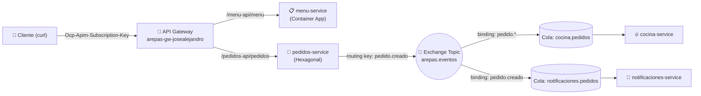

---

## 📂 2. Estructura del Repositorio (Los 4 Microservicios)

```text
arepa-express/
├── menu-service/             # Microservicio de catálogo (GET /menu)
├── pedidos-service/          # Microservicio de pedidos en Arquitectura Hexagonal + Publicador AMQP (POST /pedidos)
├── cocina-service/           # Consumidor AMQP de la cola cocina.pedidos (binding: pedido.*)
├── notificaciones-service/   # Consumidor AMQP de la cola notificaciones.pedidos (binding: pedido.creado)
└── docs/img/                 # Capturas de evidencia del despliegue en Azure, API Gateway y RabbitMQ
```

---

## ☁️ 3. Fase de Preparación del Entorno Cloud

Configuramos las variables de sesión en PowerShell y creamos el grupo de recursos `rg-arepas-josealejandro` en la región `eastus`:

```powershell
$NOMBRE = "josealejandro"
$RG     = "rg-arepas-$NOMBRE"
$LOC    = "eastus"

az login
az group create --name $RG --location $LOC
```

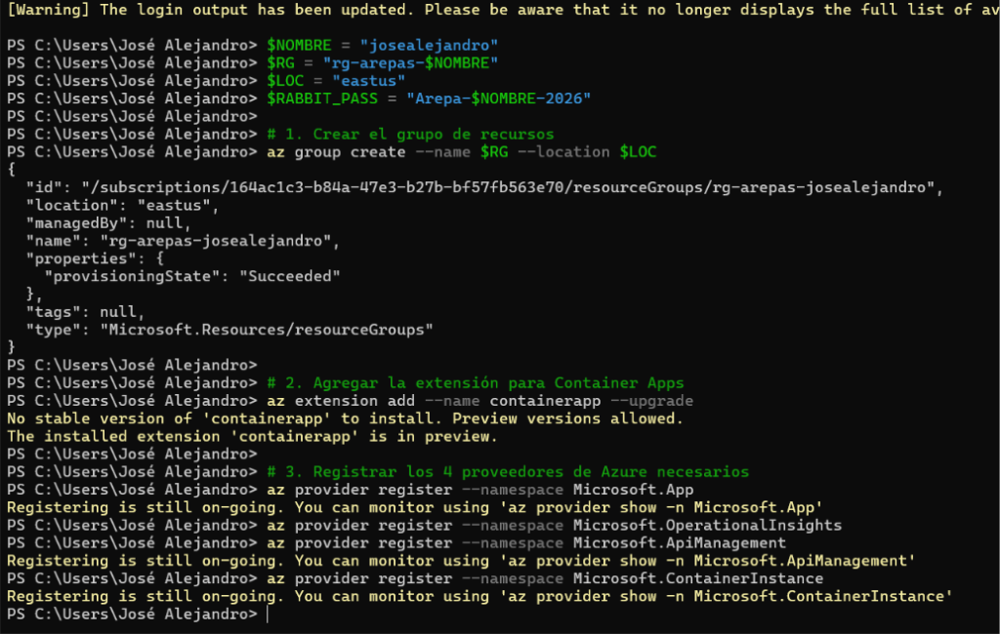

---

## 🚪 4. Sección 1: API Gateway (Una sola puerta de entrada)

### Paso 1: Microservicio de Catálogo (`menu-service`)

`menu-service` expone en `GET /menu` la lista de arepas disponibles con su nombre y precio usando un `record` inmutable de Java 21:

```java
@RestController
public class MenuController {

    public record Arepa(int id, String nombre, int precio) {}

    @GetMapping("/menu")
    public List<Arepa> menu() {
        return List.of(
            new Arepa(1, "Arepa de choclo con queso", 8500),
            new Arepa(2, "Arepa rellena de pollo", 11000),
            new Arepa(3, "Arepa de huevo", 7000)
        );
    }
}
```

---

### Paso 2: Microservicio de Gestión de Pedidos (`pedidos-service` en Arquitectura Hexagonal)

`pedidos-service` recibe los pedidos en `POST /pedidos` organizado en tres capas limpias:
- **`domain/`**: Entidad `Pedido` y puerto de salida `PedidoEventPublisher`.
- **`application/`**: Puerto de entrada `CrearPedidoUseCase` y su implementación `CrearPedidoUseCaseImpl`.
- **`infrastructure/`**: Adaptador REST `PedidoController` (`web/`) y adaptador de mensajería RabbitMQ (`messaging/`).

Verificación local de `pedidos-service` respondiendo `201 Created` (`{"estado":"RECIBIDO"}`):

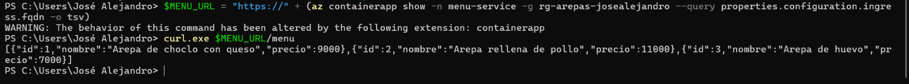

---

### Paso 3: Despliegue de los Microservicios en Azure Container Apps

Construimos las imágenes en Azure Container Registry (`ca045c9f8521acr.azurecr.io`) y desplegamos ambos servicios en el entorno `arepas-env` de Azure Container Apps:

```powershell
# Compilación y despliegue en Azure Container Apps (arepas-env)
cd menu-service
mvn -q package -DskipTests
az containerapp up --name menu-service --resource-group $RG --location $LOC --environment arepas-env --ingress external --target-port 8080 --source .

cd ../pedidos-service
mvn -q package -DskipTests
az containerapp up --name pedidos-service --resource-group $RG --location $LOC --environment arepas-env --ingress external --target-port 8080 --source .
```

Verificación de las URLs públicas de `menu-service` y `pedidos-service` corriendo en Azure Container Apps:

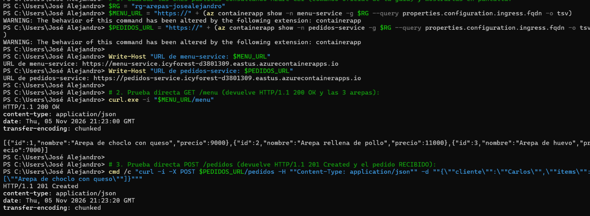
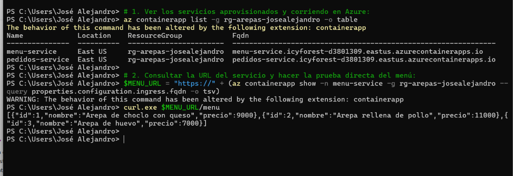

---

### Paso 4: Creación del API Gateway con Azure API Management

Creamos la instancia `arepas-gw-josealejandro` en el plan **Consumption** (serverless):

```powershell
az apim create --name arepas-gw-$NOMBRE --resource-group $RG --location $LOC --publisher-name "Arepa Express" --publisher-email "jose.alejandro-r@mail.escuelaing.edu.co" --sku-name Consumption
```

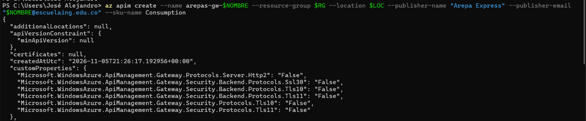
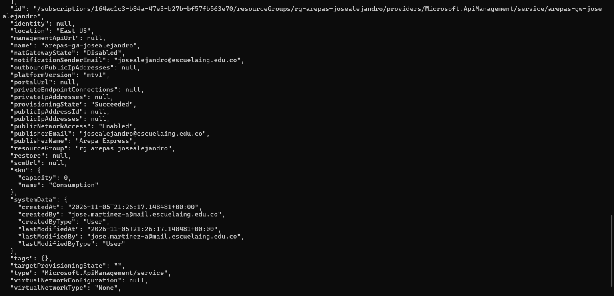

---

### Paso 5: Publicación de las APIs en el Gateway (`menu-api` y `pedidos-api`)

Registramos ambos microservicios detrás del Gateway exigiendo llave de suscripción (`--subscription-required true`):

```powershell
# 1. Menu API (GET /menu)
az apim api create --resource-group $RG --service-name arepas-gw-$NOMBRE --api-id menu-api --path menu-api --display-name "Menu API" --service-url $MENU_URL --protocols https --subscription-required true
az apim api operation create --resource-group $RG --service-name arepas-gw-$NOMBRE --api-id menu-api --operation-id get-menu --url-template "/menu" --method GET --display-name "Listar menu"

# 2. Pedidos API (POST /pedidos)
az apim api create --resource-group $RG --service-name arepas-gw-$NOMBRE --api-id pedidos-api --path pedidos-api --display-name "Pedidos API" --service-url $PEDIDOS_URL --protocols https --subscription-required true
az apim api operation create --resource-group $RG --service-name arepas-gw-$NOMBRE --api-id pedidos-api --operation-id crear-pedido --url-template "/pedidos" --method POST --display-name "Crear pedido"
```

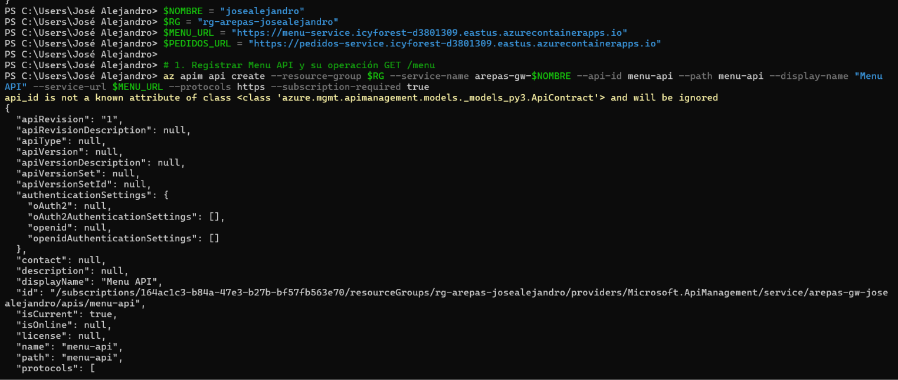
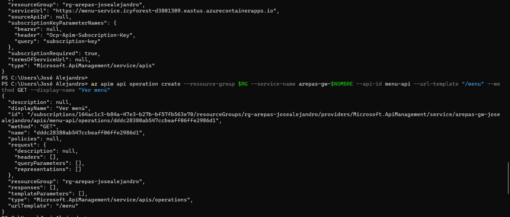
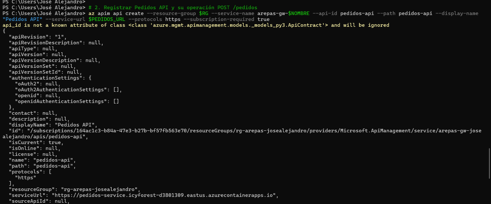
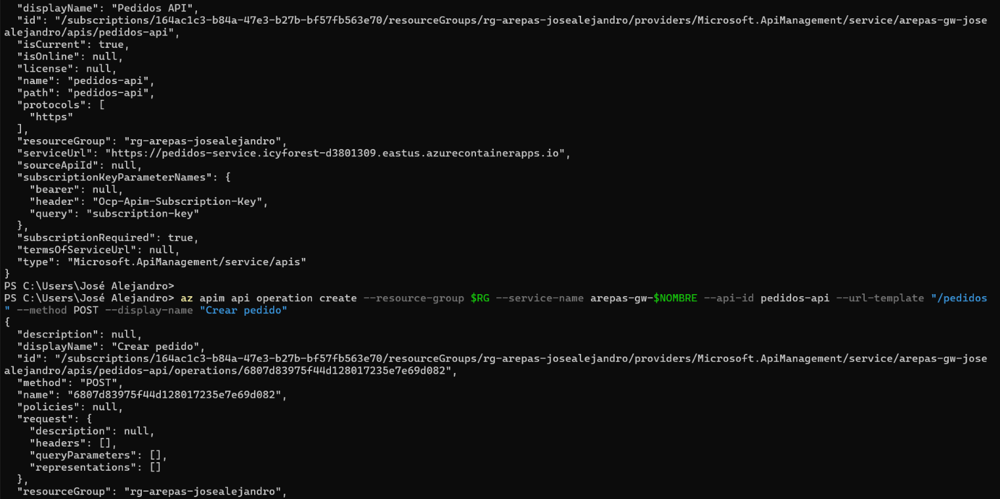
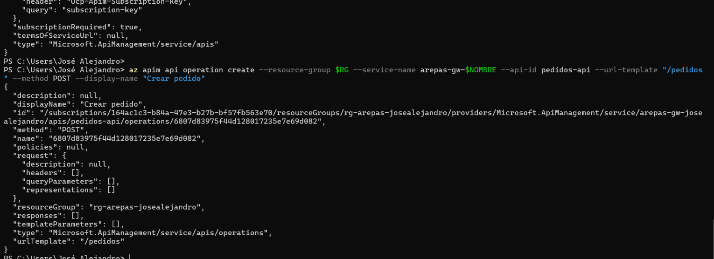

---

### Paso 6: Prueba del Gateway — Control de Acceso por Llave de Suscripción

Probamos primero **sin llave** (el Gateway rechaza con `401 Access Denied` sin tocar el contenedor) y luego **con el header `Ocp-Apim-Subscription-Key`** (respondiendo `200 OK` en `/menu-api/menu` y `201 Created` en `/pedidos-api/pedidos`):

```powershell
# 1. Sin API Key -> 401 Access Denied
curl.exe -i https://arepas-gw-$NOMBRE.azure-api.net/menu-api/menu

# 2. Con API Key -> 200 OK y 201 Created
curl.exe -i -H "Ocp-Apim-Subscription-Key: $KEY" https://arepas-gw-$NOMBRE.azure-api.net/menu-api/menu
cmd /c "curl -i -X POST https://arepas-gw-$NOMBRE.azure-api.net/pedidos-api/pedidos -H ""Ocp-Apim-Subscription-Key: $KEY"" -H ""Content-Type: application/json"" -d ""{\""cliente\"":\""María\"",\""arepas\"":[\""choclo\"",\""pollo\""]}"""
```

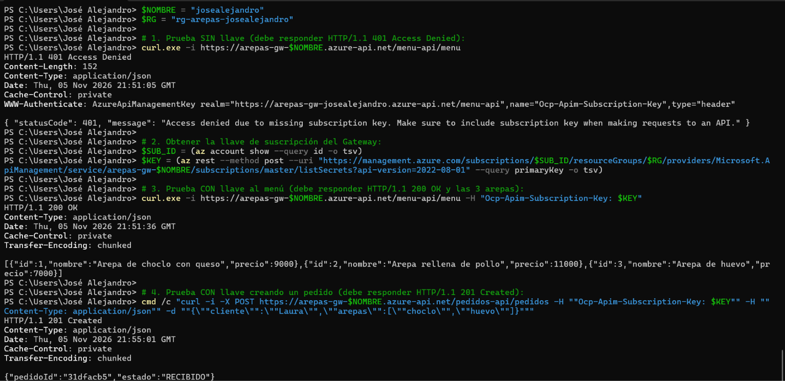

---

### Paso 7: Agregación de una Política de Salida al Gateway (`X-Arepa-Gateway`)

Configuramos en la sección `<outbound>` de `Menu API` una política XML para que el Gateway inyecte el header `X-Arepa-Gateway: DOSW Company` en todas las respuestas:

```xml
<policies>
    <inbound>
        <base />
    </inbound>
    <backend>
        <base />
    </backend>
    <outbound>
        <base />
        <set-header name="X-Arepa-Gateway" exists-action="override">
            <value>DOSW Company</value>
        </set-header>
    </outbound>
    <on-error>
        <base />
    </on-error>
</policies>
```

Verificación con `curl.exe -i` mostrando `X-Arepa-Gateway: DOSW Company` en las cabeceras de respuesta:

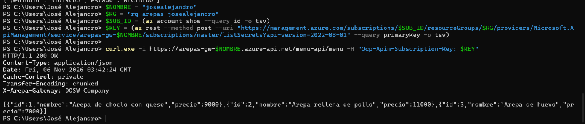

---

## 🐰 5. Sección 2: Eventos con RabbitMQ (Avisar sin esperar)

### Paso 8: Despliegue de RabbitMQ en Azure Container Instances (ACI)

Desplegamos `rabbitmq:3-management` en Azure Container Instances exponiendo el puerto `5672` (AMQP) y el `15672` (consola web):

```powershell
az container create --resource-group $RG --name arepas-rabbit --image rabbitmq:3-management --os-type Linux --cpu 1 --memory 1.5 --ports 5672 15672 --ip-address Public --dns-name-label arepas-rabbit-$NOMBRE --environment-variables RABBITMQ_DEFAULT_USER=arepas RABBITMQ_DEFAULT_PASS=Arepa-$NOMBRE-2026
```

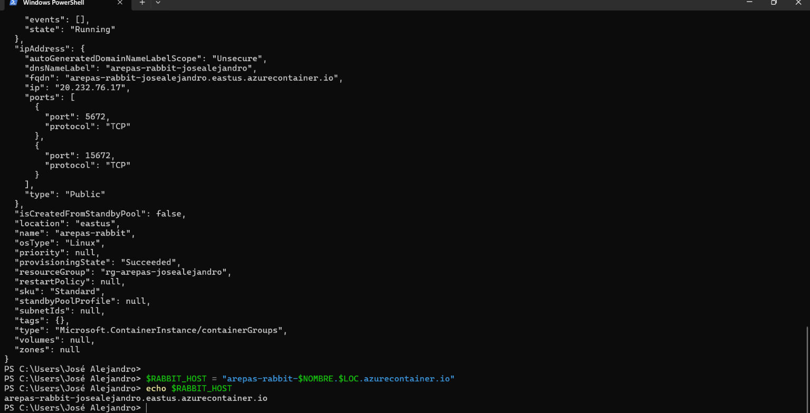

---

### Paso 9: Acceso al Panel de Administración de RabbitMQ

Ingresamos a `http://arepas-rabbit-josealejandro.eastus.azurecontainer.io:15672` con el usuario `arepas` para verificar el estado inicial del broker:

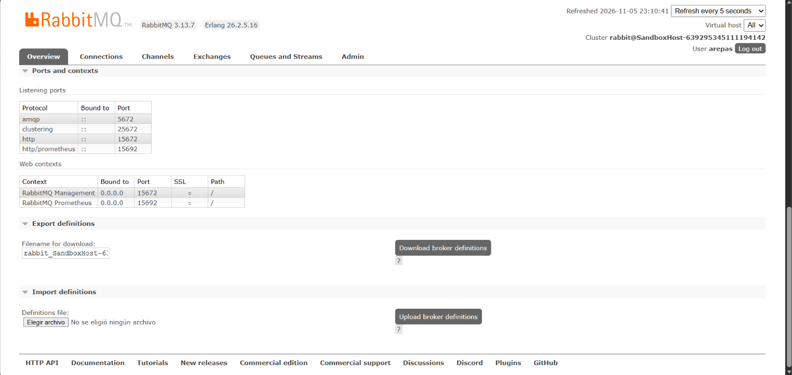

---

### Paso 10: Publicación de Eventos en `pedidos-service` (Puerto de Salida Hexagonal)

Actualizamos `pedidos-service` agregando `spring-boot-starter-amqp`. El caso de uso `CrearPedidoUseCaseImpl` invoca el puerto de salida `PedidoEventPublisher`, cuya implementación en infraestructura (`RabbitPedidoEventPublisherImpl`) publica el `PedidoCreadoEvent` en el `TopicExchange` `arepas.eventos` con la routing key `pedido.creado`:

```java
@Component
public class RabbitPedidoEventPublisherImpl implements PedidoEventPublisher {

    private final RabbitTemplate rabbit;

    public RabbitPedidoEventPublisherImpl(RabbitTemplate rabbit) {
        this.rabbit = rabbit;
    }

    @Override
    public void publicarPedidoCreado(PedidoCreadoEvent event) {
        rabbit.convertAndSend(RabbitConfig.EXCHANGE, RabbitConfig.ROUTING_KEY_CREADO, event);
    }
}
```

---

### Paso 11: Creación del Consumidor de Cocina (`cocina-service`)

`cocina-service` declara su cola durable `cocina.pedidos` y la enlaza al exchange `arepas.eventos` con el patrón `pedido.*`:

```java
@Component
public class CocinaListener {

    private static final Logger log = LoggerFactory.getLogger(CocinaListener.class);

    @RabbitListener(queues = RabbitConfig.QUEUE)
    public void preparar(PedidoCreadoEvent ev) throws InterruptedException {
        log.info("🔥 Preparando {} para {} (pedido {})", ev.arepas(), ev.cliente(), ev.pedidoId());
        Thread.sleep(3000);
        log.info("✅ Pedido {} listo", ev.pedidoId());
    }
}
```

---

### Paso 12: Creación del Consumidor de Notificaciones (`notificaciones-service`)

`notificaciones-service` declara su propia cola durable `notificaciones.pedidos` enlazada con la routing key `pedido.creado`:

```java
@Component
public class NotificacionesListener {

    private static final Logger log = LoggerFactory.getLogger(NotificacionesListener.class);

    @RabbitListener(queues = RabbitConfig.QUEUE)
    public void notificar(PedidoCreadoEvent ev) {
        log.info("📲 Hola {}, recibimos tu pedido {}. ¡Ya lo estamos preparando!",
                 ev.cliente(), ev.pedidoId());
    }
}
```

---

### Paso 13: Despliegue y Conexión de los Microservicios con RabbitMQ

Compilamos y desplegamos `pedidos-service` (v2), `cocina-service` y `notificaciones-service` en Azure Container Apps inyectándoles `RABBIT_HOST`, `RABBIT_USER` y `RABBIT_PASS`, y fijando `--min-replicas 1 --max-replicas 1` en los consumidores para que siempre estén escuchando a RabbitMQ:

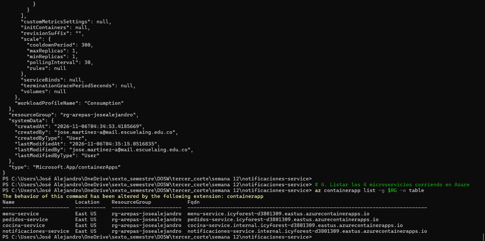
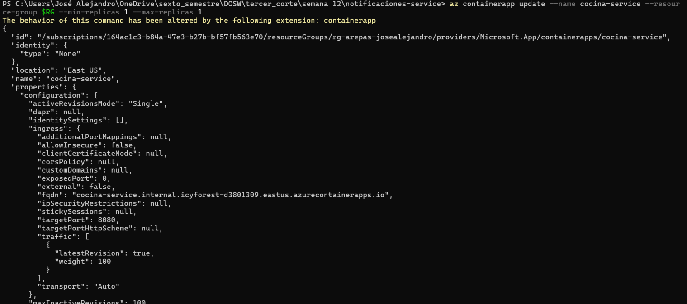
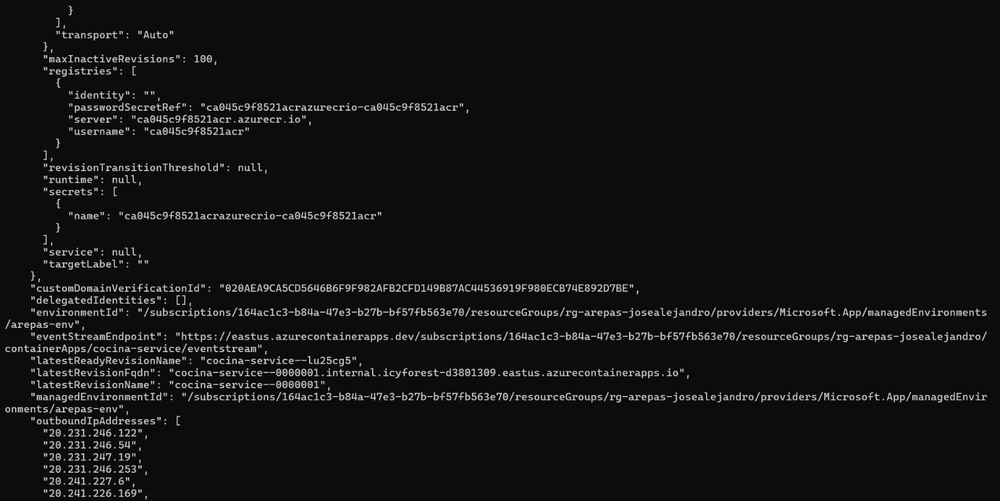
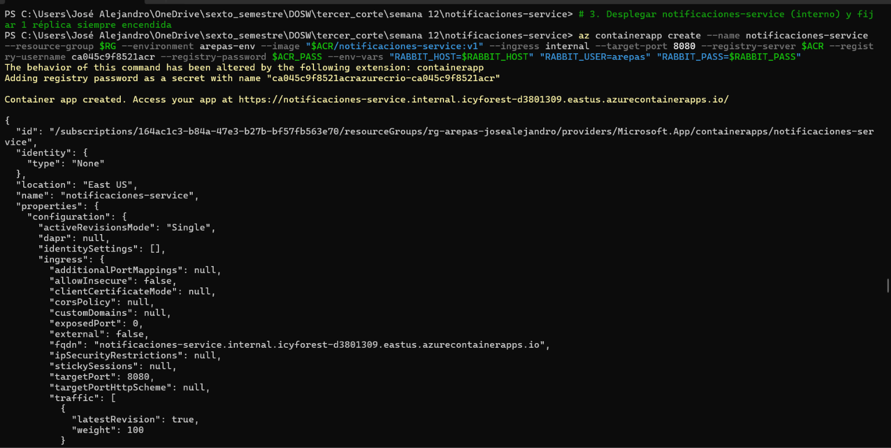
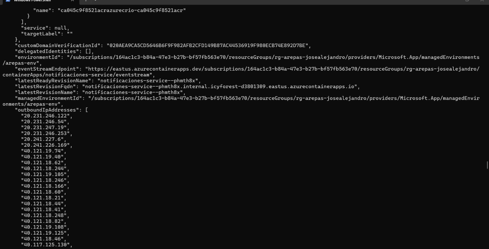
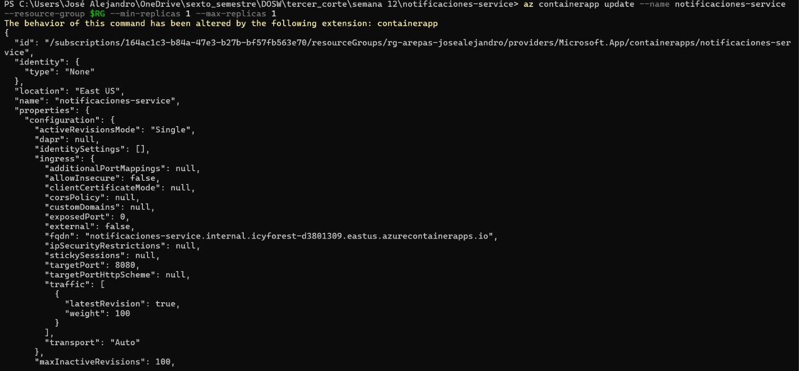
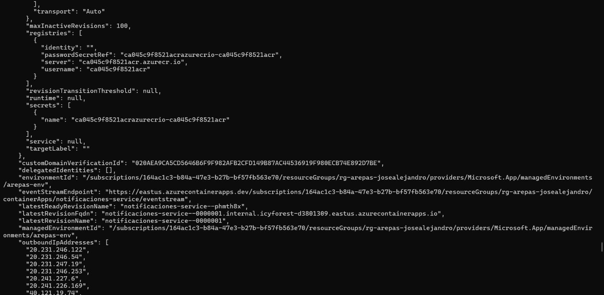

---

### Paso 14: Prueba de Punta a Punta (Cliente → API Gateway → `pedidos-service` → RabbitMQ → Consumidores)

Abrimos dos terminales siguiendo los logs en vivo de `cocina-service` y `notificaciones-service` en Azure, y desde una tercera terminal enviamos un pedido para `"Andrés"` a través del API Gateway:

```powershell
cmd /c "curl -X POST https://arepas-gw-$NOMBRE.azure-api.net/pedidos-api/pedidos -H ""Ocp-Apim-Subscription-Key: $KEY"" -H ""Content-Type: application/json"" -d ""{\""cliente\"":\""Andrés\"",\""arepas\"":[\""pollo\"",\""choclo\""]}"""
```

1. **Terminal 3 (Petición al API Gateway — responde inmediatamente `{"pedidoId":"258224d4","estado":"RECIBIDO"}`):**
   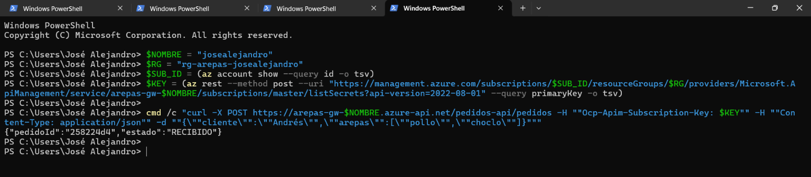

2. **Terminal 2 (`notificaciones-service` recibe el evento y envía el mensaje a Andrés al instante):**
   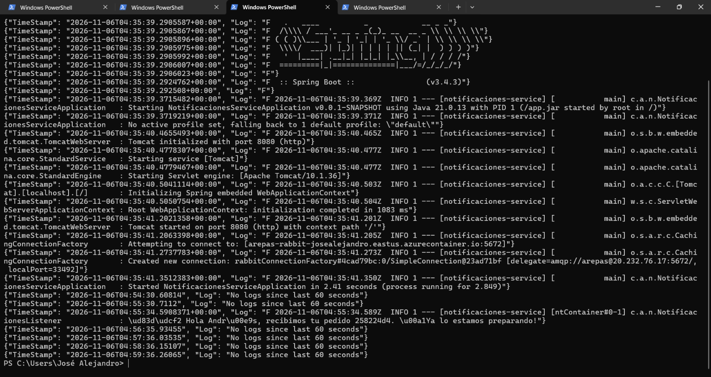

3. **Terminal 1 (`cocina-service` recibe el mismo evento en paralelo, prepara las arepas 3 segundos y marca el pedido `258224d4` como listo):**
   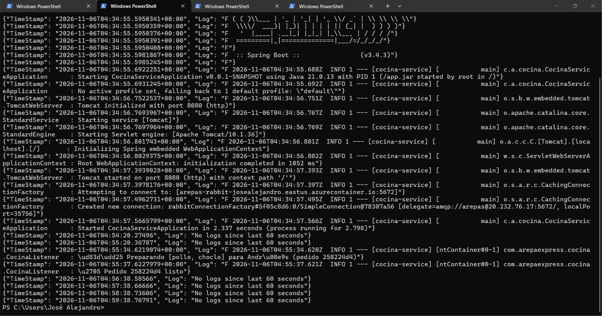

4. **Panel de RabbitMQ (`Exchanges -> arepas.eventos` con ambos bindings y `Queues and Streams` con las colas `cocina.pedidos` y `notificaciones.pedidos`):**
   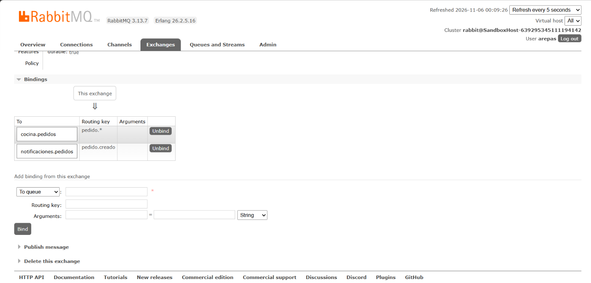
   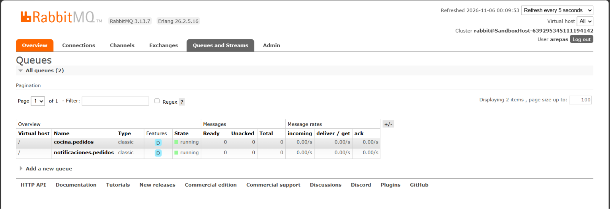

---

## ✅ 6. Registro de Evidencias Obligatorias del Laboratorio (Qué entregar)

A continuación se consolidan directamente las **4 evidencias obligatorias** solicitadas en la sección **"Qué entregar"** de la guía del laboratorio:

### Evidencia Oficial 1 — El Gateway respondiendo `401` sin API Key y `200`/`201` con API Key
Al invocar `GET /menu-api/menu` sin cabecera `Ocp-Apim-Subscription-Key`, el API Gateway rechaza la petición en el perímetro con `HTTP/1.1 401 Access Denied` sin tocar el contenedor; al incluir la llave válida responde `200 OK` y `201 Created`:


---

### Evidencia Oficial 2 — El Gateway respondiendo `200` con API Key y el header `X-Arepa-Gateway: DOSW Company`
Tras aplicar la política `<set-header name="X-Arepa-Gateway" exists-action="override"><value>DOSW Company</value></set-header>` en la fase `<outbound>` del API Gateway, la respuesta HTTP incluye la cabecera personalizada `X-Arepa-Gateway: DOSW Company`:


---

### Evidencia Oficial 3 — El panel de RabbitMQ mostrando el exchange `arepas.eventos`, las dos colas y sus bindings
Vista de RabbitMQ Management mostrando el exchange tipo `topic` **`arepas.eventos`** enlazado a `cocina.pedidos` (`pedido.*`) y a `notificaciones.pedidos` (`pedido.creado`), así como ambas colas durables en estado `running`:


---

### Evidencia Oficial 4 — Los logs de `cocina-service` y `notificaciones-service` procesando el mismo pedido al mismo tiempo
Al enviar el pedido de `"Andrés"` (`pedidoId: 258224d4`) al API Gateway, `pedidos-service` publica el evento una sola vez en `arepas.eventos` y ambos microservicios consumidores (`notificaciones-service` y `cocina-service`) lo reciben y procesan simultáneamente:


---

## 🧪 7. Resultados de los Tres Experimentos

### Experimento 1 — Uno a muchos (¿Qué pasaría si cocina y notificaciones leyeran de la misma cola?)
En nuestra arquitectura cada servicio tiene su propia cola (`cocina.pedidos` y `notificaciones.pedidos`) unida al exchange `arepas.eventos`, por lo que RabbitMQ entrega una copia del pedido a ambos. Si en cambio pusiéramos a `cocina-service` y a `notificaciones-service` a leer de una única cola compartida, se activaría el patrón de **consumidores competitivos (Round-Robin)**: cada mensaje de una cola lo procesa un solo consumidor. En consecuencia, el pedido 1 lo tomaría cocina (se prepara la arepa pero nunca se le notifica al cliente) y el pedido 2 lo tomaría notificaciones (se le avisa al cliente que ya se está preparando, pero la cocina jamás se entera del pedido). Por eso para publicar un evento a distintos sistemas interesados cada uno debe tener su propia cola enlazada al exchange.

### Experimento 2 — Cola de trabajo (Escalamiento a 2 réplicas de `cocina-service`)
Al escalar `cocina-service` a 2 réplicas con:
```powershell
az containerapp update --name cocina-service --resource-group $RG --min-replicas 2 --max-replicas 2
```
y enviar 6 pedidos seguidos, ambas réplicas se conectan a la misma cola `cocina.pedidos` (en el panel de RabbitMQ la cola pasa a mostrar **`Consumers: 2`**). Aquí sí queremos que lean de la misma cola porque son dos instancias del mismo servicio: RabbitMQ reparte los 6 pedidos entre las dos réplicas (3 pedidos cada una) evitando que una arepa se cocine dos veces y reduciendo a la mitad el tiempo total de atención.

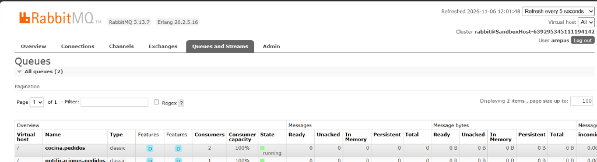

### Experimento 3 — Los mensajes esperan (Cola `auditoria.pedidos` sin consumidor activo)
Al crear la cola durable `auditoria.pedidos` en el panel de RabbitMQ y unirla al exchange `arepas.eventos` con la routing key `pedido.#`, al enviar 3 nuevos pedidos observamos que cocina y notificaciones consumen sus mensajes inmediatamente (quedando en `Ready: 0`), pero en la cola `auditoria.pedidos` los 3 mensajes se quedan guardados esperando (`Ready: 3` / `Total: 3`) porque no hay ningún microservicio conectado leyéndola. Esto demuestra en la práctica que un servicio caído o en mantenimiento no pierde eventos: el broker los retiene hasta que el consumidor vuelva a estar disponible.

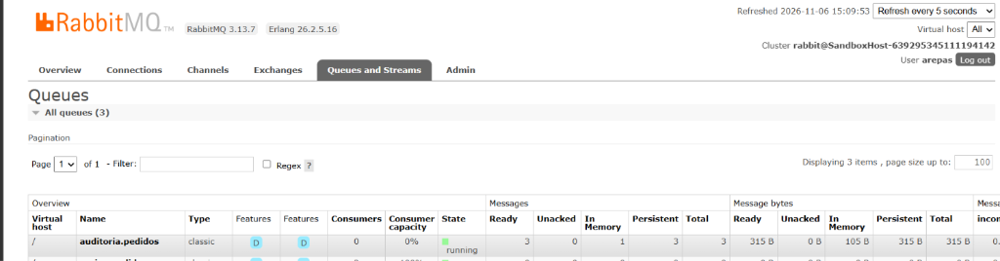

---

## 💡 8. Respuestas a las Preguntas para Pensar

1. **¿Qué pasa con los pedidos si `cocina-service` se cae por 5 minutos?**  
   No se pierde ningún pedido ni se cae el sistema para los clientes. Durante esos 5 minutos, `pedidos-service` sigue recibiendo órdenes por el API Gateway, respondiendo `201 Created` (`RECIBIDO`) y publicando los eventos en RabbitMQ, mientras que `notificaciones-service` sigue enviando los avisos normalmente. Los mensajes para la cocina se quedan guardados de forma segura en la cola durable `cocina.pedidos` (igual que vimos con `auditoria.pedidos` en el Experimento 3). Apenas `cocina-service` se recupere a los 5 minutos, se reconecta a su cola y procesa en orden todos los pedidos que quedaron represados.

2. **¿Por qué el gateway devuelve `401` sin que el servicio se entere?**  
   Porque el API Gateway actúa como la única puerta de entrada (proxy inverso perimetral). Cuando llega una petición HTTP, antes de reenviarla hacia el contenedor de Container Apps, el Gateway ejecuta la fase `Inbound` y verifica si incluye el header `Ocp-Apim-Subscription-Key` con una llave válida. Si no viene, el propio Gateway rechaza la llamada en la puerta con `401 Access Denied` sin tocar el microservicio de backend, protegiéndolo de tráfico no autorizado y ahorrando recursos de cómputo.

3. **¿Dónde validarías el token de un usuario: en el gateway o en cada microservicio?**  
   La validación de autenticidad del token JWT (verificar firma criptográfica, expiración e issuer con una política `validate-jwt`) la haría en el **API Gateway** para frenar tokens inválidos o vencidos en el perímetro sin cargar a los microservicios. Sin embargo, para las reglas específicas de negocio o permisos internos de cada dominio (autorización fina por rol/usuario), el Gateway puede pasar los claims ya validados a los microservicios para que cada uno verifique si ese usuario puede ejecutar la acción solicitada.

4. **¿Qué pasa si el pedido se crea pero el evento no se alcanza a publicar?**  
   Habría una inconsistencia: el cliente recibe confirmación (o el pedido queda guardado en base de datos), pero si justo antes de publicar en RabbitMQ se cae la red o el contenedor, ni cocina ni notificaciones se enteran de que existe ese pedido. En sistemas reales esto se resuelve con el patrón **Transactional Outbox**: en la misma transacción de base de datos donde se guarda el pedido se inserta el evento en una tabla local `outbox`, y un worker publica los eventos pendientes en RabbitMQ con reintentos hasta recibir confirmación del broker.

5. **¿Cuándo usarías una cola y cuándo un tópico en Style Radar?**  
   - **Usaría una cola (punto a punto / cola de trabajo)** cuando una tarea debe ser ejecutada una sola vez repartiendo la carga entre varias réplicas del mismo servicio; por ejemplo, en **Style Radar** para procesar imágenes de prendas subidas por los usuarios o generar sugerencias de outfits pesados en background.
   - **Usaría un tópico (Topic Exchange como `arepas.eventos`)** cuando ocurre un hecho del negocio que le interesa a varios microservicios distintos al mismo tiempo; por ejemplo, cuando se publica el evento `compra.confirmada` en **Style Radar**, para que a la vez el servicio de catálogo/inventario actualice las unidades disponibles, el servicio de pagos/facturación emita el comprobante y el servicio de notificaciones le avise al comprador.

---

## 🧹 9. Limpieza de Recursos en Azure

Una vez tomadas todas las evidencias del laboratorio, eliminamos el grupo de recursos completo para no consumir créditos de *Azure for Students*:

```powershell
az group delete --name $RG --yes --no-wait
```
